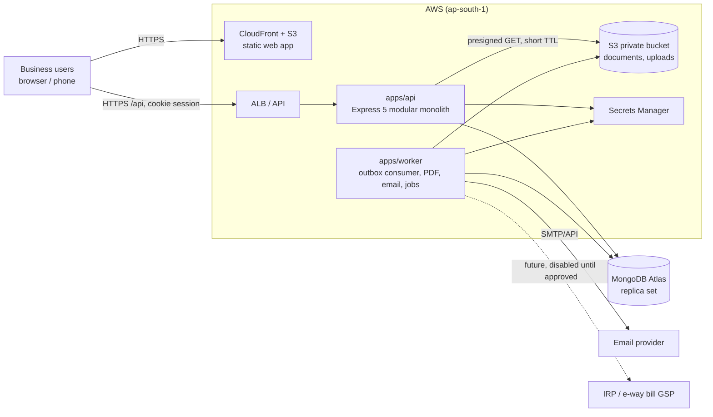
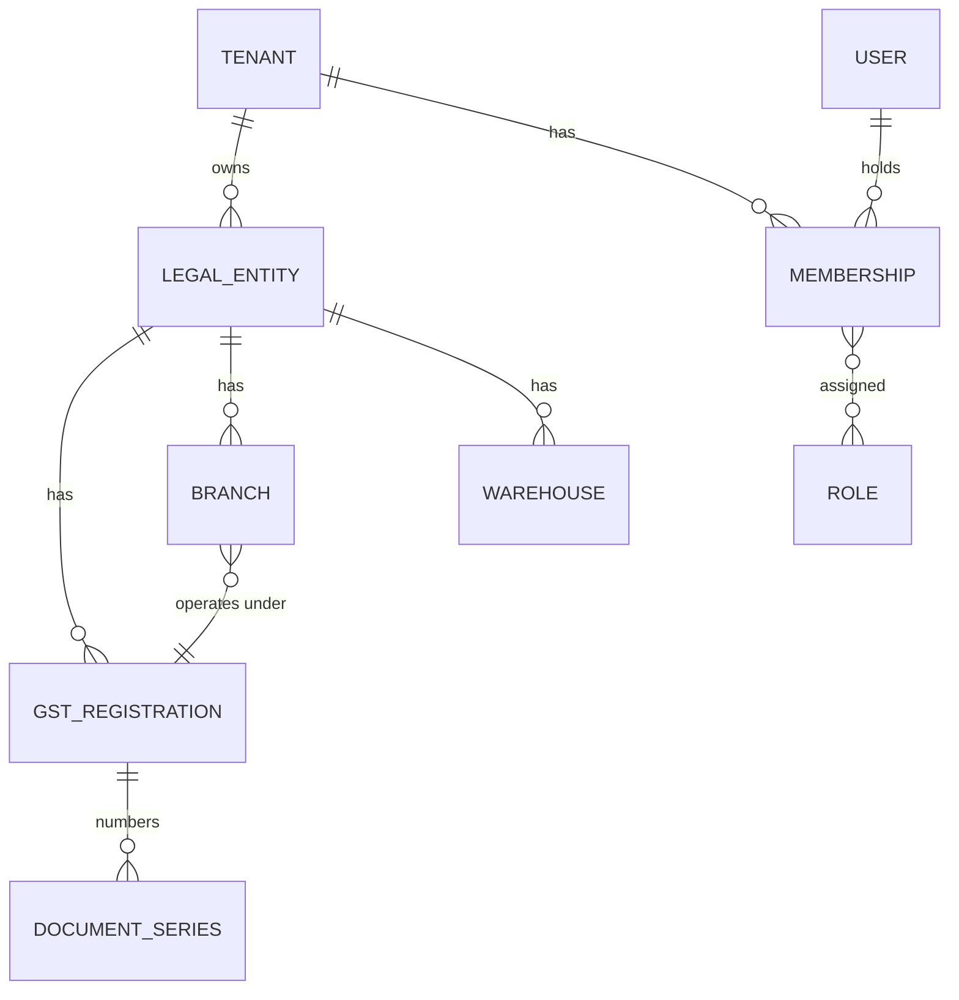

# Architecture Overview

Status: Draft v0.1 · 2026-10-19 · Decisions: [decisions.md](decisions.md)

## 1. Style
**Modular monolith** (one deployable API) + **one background worker** process,
sharing typed contracts and domain logic through workspace packages. No
microservices. One database (MongoDB Atlas). One queue strategy: a
**transactional outbox in MongoDB** consumed by the worker (ADR-005).

## 2. System context



## 3. Repository and module layout

```
apps/
  web/        React SPA (Vite). Talks only to /api. No secrets.
  api/        HTTP layer + module wiring. One process.
  worker/     Outbox consumer and scheduled jobs. No HTTP surface except health.
packages/
  contracts/  Zod schemas + TS types shared by web/api/worker (request/response, error envelope, decimal strings).
  domain/     Pure, deterministic logic: decimal money, tax computation, rounding, allocation, state machines. No I/O.
  ui/         Design-system components (Phase 2).
```

API internal modules (each a folder under `apps/api/src/modules/<name>` with
`routes`, `service`, `repository`, `schemas`):

| Module | Owns collections |
|---|---|
| identity | users, sessions, mfaFactors, passwordResets, loginAttempts |
| tenancy | tenants, legalEntities, gstRegistrations, branches, memberships, roles |
| audit | auditEvents |
| parties | parties, crmTasks, crmNotes |
| catalogue | items, categories, units, taxClasses, taxRateSchedules, priceLists |
| inventory | warehouses, stockMovements, stockBalances, reservations, transfers, stockCounts |
| sales | quotations, salesOrders, dispatches, salesInvoices |
| purchasing | purchaseOrders, goodsReceipts, supplierBills |
| money | receipts, payments, allocations, expenses |
| adjustments | returns, creditNotes, debitNotes |
| ledger | accounts, journals, periodLocks |
| platform | sequences, idempotencyKeys, outbox, files, documentArtifacts |
| reporting | read models / aggregation pipelines (no own source-of-truth data) |

Rules: a module calls another only via its exported service interface, never its
repository; cross-module writes that must be atomic share a transaction session
passed explicitly (`withTransaction(ctx, fn)`).

## 4. Request pipeline (API)
1. `requestId` (accept inbound `X-Request-Id` only if it matches `^[A-Za-z0-9-]{8,64}$`, else generate).
2. Security headers (Helmet), strict CORS allowlist, body size limit (default 256 KB JSON), JSON-only content type for mutating requests.
3. Session resolution (cookie → hashed lookup → user) — Phase 3.
4. CSRF check for unsafe methods — Phase 3.
5. Tenant context: `X-Tenant-Id` + `X-Legal-Entity-Id` headers validated against membership → immutable `RequestContext` — Phase 3.
6. Rate limit by route class.
7. Zod validation of params/query/body (strict objects → mass-assignment protection).
8. Permission check (`requirePermission('invoice.issue')`).
9. Service executes; repositories **require** `RequestContext` and inject `tenantId`/`legalEntityId` filters themselves.
10. Error handler maps known errors to the envelope; unknown errors → 500 `INTERNAL` with requestId, details only in logs.

## 5. Tenant / entity / registration model


- **Tenant** = the subscribing organization (billing, users). Isolation boundary.
- **Legal entity** = a PAN-level business (proprietorship, partnership, company). Books, period locks, valuation are per legal entity.
- **GST registration** = a GSTIN (state-specific) under a legal entity; document series are per registration for GST documents.
- **Branch / warehouse** = operating locations.
- Masters (parties, items) are tenant-scoped and may be shared across legal entities of the same tenant; balances are per legal entity.

## 6. Transaction boundaries
MongoDB multi-document transactions (replica set, `readConcern: snapshot`,
`writeConcern: majority`) wrap each command below. **No external calls, email,
PDF rendering, or object-storage writes inside a transaction** — those are
emitted as outbox rows in the same transaction.

| Command | Atomic writes |
|---|---|
| Issue invoice | sequence increment, invoice status+number+snapshot, stock movements + balances (if stock-out = invoice), reservation consumption, journal, idempotency record, outbox(`invoice.issued`), audit |
| Dispatch | dispatch status, movements + balances, reservation consumption, outbox, audit |
| Post receipt + allocations | receipt, allocations, invoice outstanding/payment status, journal, outbox, audit |
| Transfer dispatch/receive | transfer, movements + balances (source/transit/destination) |
| Cancel invoice | status, reversal movements + balances, reversal journal, outbox, audit |

Transactions retry on `TransientTransactionError` / `UnknownTransactionCommitResult`
with exponential backoff and full jitter, within a 60-second budget
(`platform/transactions.ts`; a fixed small retry count would fail most of 100
concurrent issuers of one series, AC-NUM-1). Commands are idempotent so
retries cannot double-post.

## 7. Idempotency
- All non-safe financial/stock commands require `Idempotency-Key` (UUID v4/v7, ≤ 64 chars).
- Record: `{tenantId, userId, key, method, route, requestHash(SHA-256 of canonical JSON body), status, responseSnapshot, createdAt, expiresAt(24h)}`; unique on `(tenantId, key)`.
- Flow: insert `in_progress` inside the command's transaction → on commit store response. Same key + same hash → replay stored response (or `409 IDEMPOTENCY_IN_PROGRESS` if still running). Same key + different hash → `422 IDEMPOTENCY_KEY_REUSED`.
- Implementation (Phase 6, `platform/idempotency.ts`): the route middleware checks the key and runs the command with the claim in `AsyncLocalStorage`; `withTransaction` inserts the record (status `committed`) at the start of the command's transaction, so the record exists exactly when the effects do. A failed command leaves no record and can be retried with the same key. After commit the response is stored (`completed`) and replays carry `Idempotent-Replayed: true`. A committed command whose response was not stored (crash in between) answers 409 and the client reloads. Required on stock posting commands; financial documents join in Phases 7–9.

## 8. Document numbering
- `sequences` collection, one document per `(tenantId, scopeId=registration|legalEntity, docType, financialYear)` with `next` counter and format (`prefix`, `padding`, `suffix`).
- Number assigned only at issue, inside the issuing transaction, via `findOneAndUpdate({$inc:{next:1}})` with the session — transactional write conflicts serialize concurrent issuers; aborted transactions roll the counter back, so **no gaps from failures** and **no reuse**.
- Unique index on `(tenantId, scopeId, docType, financialYear, number)` on each document collection as the final guard.
- Cancelled documents keep their numbers.
- Format must satisfy GST invoice-number rules (≤ 16 chars; letters, digits, `-` and `/`) — see compliance doc.

## 9. Outbox and worker
- Outbox row: `{_id, tenantId, type, aggregateId, payload(minimal IDs), status, attempts, availableAt, leaseUntil, lastError}`.
- Worker claims with `findOneAndUpdate({status:'pending', availableAt≤now} → processing, leaseUntil=now+60s)`; expired leases are reclaimable.
- Handlers are idempotent (keyed by outbox `_id`); exponential backoff with cap; after N attempts → `dead` + alert.
- Change streams may later replace polling as a latency optimization; polling at 1 s is the baseline.
- Scheduled jobs (quotation expiry, reconciliation, ageing snapshots) run in the worker with a distributed lock document so only one instance runs each job.

## 10. Files and documents
- `ObjectStorage` interface (`put`, `getSignedUrl`, `head`, `delete`) with S3 and local-filesystem (dev: `PROJECT_ROOT/.artifacts/storage`) implementations.
- Bucket private; keys are random IDs, never user file names; metadata in `files` collection with tenant scope.
- Downloads: API authorizes, then returns a presigned URL (TTL ≤ 60 s) or streams.
- PDF rendering: programmatic generator (no HTML fetching → no SSRF surface) in the worker; bundled OFL fonts with ₹ glyph (ADR-006).

## 11. Frontend architecture
- React SPA, React Router, TanStack Query for server state (no auth state in localStorage), React Hook Form + Zod resolvers using `packages/contracts` schemas.
- Money displayed via `Intl.NumberFormat('en-IN', {style:'currency', currency:'INR'})` from decimal strings; the browser never performs authoritative calculation — it shows a server-computed **preview** (`POST /…:preview`).
- Permission-aware UI from `/api/v1/me` (hides actions; server still enforces).

## 12. Deployment (preparation only — nothing provisioned)
- Web: S3 + CloudFront with OAC, CSP headers via response-headers policy.
- API and worker: containers on ECS Fargate (separate services, same image, different command) behind an ALB; or a single EC2/Lightsail for pilot. Secrets via AWS Secrets Manager.
- MongoDB Atlas M10+ (replica set, continuous backup) in AWS Mumbai region, private endpoint / IP allowlist.
- Region `ap-south-1` (Mumbai) for data residency preference (legal review item).
