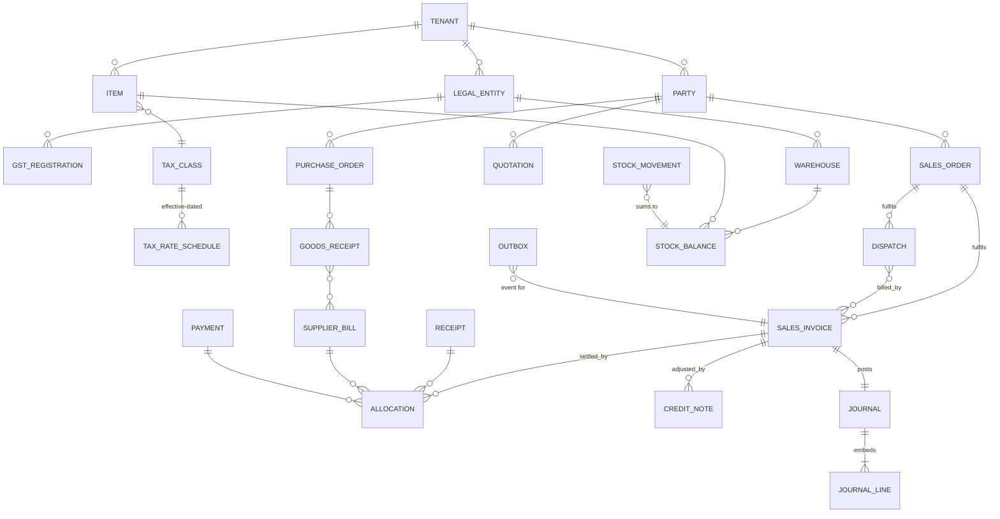

# Database Schema, ER Model and Index Plan (MongoDB)

Status: Draft v0.1 · 2026-10-19 · Engine: MongoDB Atlas replica set (ADR-002)

Conventions
- `_id`: ObjectId. All money/quantity fields `Decimal128`. Timestamps UTC `Date`; business dates (`docDate`) stored as `YYYY-MM-DD` strings interpreted in IST.
- Every tenant-owned document has `tenantId`; ledger/stock/document collections also have `legalEntityId`.
- `version` (int) on mutable documents for optimistic concurrency.
- `createdBy`, `createdAt`, `updatedBy`, `updatedAt` on all; issued financial docs add `issuedBy`, `issuedAt`.
- Soft archive (`archivedAt`) for masters; **no deletes** for referenced or issued records.
- Financial collections get `$jsonSchema` validators (`validationAction: error`).

## 1. ER overview

## 2. Collections

### Platform / identity
| Collection | Key fields |
|---|---|
| `users` | email (lower-cased, unique), passwordHash, status, mfa{enabled, factorIds}, lastLoginAt, failedLoginCount, lockedUntil |
| `sessions` | tokenHash (unique), userId, tenantId?, createdAt, lastSeenAt, idleExpiresAt, absoluteExpiresAt, mfaLevel, ipHash, userAgent, revokedAt |
| `mfaFactors` | userId, type `totp`, secretEnc (envelope-encrypted), recoveryCodeHashes[] |
| `tenants` | name, status, plan, createdAt |
| `memberships` | tenantId, userId, status, roleAssignments[{roleId, legalEntityIds[]|'*', warehouseIds[]|'*'}] |
| `roles` | tenantId, name, system (bool), permissions[] |
| `auditEvents` | tenantId, at, actorId, action, entityType, entityId, requestId, ipHash, diff (redacted) — append-only |
| `idempotencyKeys` | tenantId, key, userId, route, requestHash, status(committed/completed), responseStatus, responseBody, createdAt, expiresAt (TTL 24 h) — inserted inside the command's transaction |
| `documentSeries` | tenantId, legalEntityId, gstRegistrationId?, scopeId (registration or entity), docType, name, prefix (may contain `{FY}`), padding, startNumber, isDefault, active, version |
| `sequences` | tenantId, seriesId, fy, next, issuedCount — one counter per series per financial year, created before the first issue; incremented only inside the issuing transaction. `issuedCount > 0` locks the series format |
| `outbox` | tenantId, type, aggregateId, payload, status(pending/processing/done/dead), attempts, availableAt, leaseUntil, lastError, createdAt, doneAt |
| `files` | tenantId, storageKey (random), mime, size, sha256, purpose, createdAt |
| `documentArtifacts` | tenantId, docType, docId, templateVersion (unique together), status(pending/ready/failed), fileId, attempts, lastError |
| `jobLocks` | _id (job name), owner, lockedUntil, lastStartedAt, lastFinishedAt, lastResult — not tenant data |
| `integrityChecks` | tenantId, kind(stock/journals) (unique together), checkedAt, ok, issueCount, summary — latest scheduled result |

### Organization and masters
| Collection | Key fields |
|---|---|
| `legalEntities` | tenantId, legalName, tradeName, pan, constitution, fyStartMonth, settings{stockOutPoint, stockInPoint, allowNegativeStock, roundOffTotal, turnoverBand}, periodLockDate, logo{fileId, contentType, sizeBytes, width, height}? (Phase 7) |
| `gstRegistrations` | tenantId, legalEntityId, gstin, stateCode, type(regular/composition), effectiveFrom/To, address, einvoice{mode, status} |
| `branches` | tenantId, legalEntityId, gstRegistrationId, name, address |
| `warehouses` | tenantId, legalEntityId, branchId?, code, name, address, active |
| `parties` | tenantId, kind{customer, supplier}, name, gstins[{gstin, stateCode, addressId}], pan, addresses[], contacts[], creditLimit, paymentTermsDays, tags[] |
| `crmTasks` / `crmNotes` | tenantId, partyId, assigneeId, dueAt, status, body |
| `items` | tenantId, sku (unique per tenant), name, type(stock/non_stock/service), categoryId, baseUnitId, altUnits[{unitId, factor}], hsnSac, taxClassId, salePrice, purchasePrice, reorderLevel |
| `units` | tenantId, code (e.g. NOS, KGS per GST UQC list), decimals |
| `taxClasses` | tenantId, name, nameKey, kind(goods/service), treatment(taxable/exempt/nil_rated/non_gst), reverseCharge, description, **schedules[]** {effectiveFrom, effectiveTo?, gstRate, cessRate?, sourceReference, verifiedBy, verifiedAt} — schedules are embedded (Phase 4) so the no-overlap check and the write are one versioned update; specific (per-unit) cess is deferred (GST-12) |
| `crmNotes` | tenantId, partyId, body, authorId, createdAt — append-only |
| `crmTasks` | tenantId, partyId, title, details, dueDate (business date), assigneeId, status(open/done/cancelled), createdBy, completedAt, version |

### Inventory
| Collection | Key fields |
|---|---|
| `warehouses` | tenantId, legalEntityId, code (unique per tenant), name, nameKey, address?, gstRegistrationId?, archivedAt, version |
| `stockMovements` | tenantId, legalEntityId, warehouseId, itemId, kind(opening/receipt/issue/transfer_out/transfer_in/adjust/return_in/return_out/revalue), qty (signed; 0 for revalue), onHandAfter, unitCost, value (signed), sourceType(stock_adjustment/stock_transfer/stock_count/dispatch/sales_invoice), sourceId, sourceNumber, sourceLineId, docDate, reversalOf?, createdBy, createdAt — append-only (model plugin) and `$jsonSchema`-validated (migration 003) |
| `stockBalances` | tenantId, legalEntityId, warehouseId, itemId, onHand, reserved (open sales orders), inTransit (incoming transfers), version — validated |
| `itemValuations` | tenantId, legalEntityId, itemId, qty (includes goods in transit), value, avgCost (null until the first receipt), version — validated |
| ~~`reservations`~~ | Not a separate collection (Phase 7): each sales order line holds `reservedQty`, and `stockBalances.reserved` = Σ of those over open orders per warehouse and item (checked by reconciliation) |
| `stockAdjustments` | tenantId, legalEntityId, warehouseId, number (OPN-/ADJ-nnnnnn), type(opening/adjustment), status(draft/posted/cancelled), reason, note, docDate, lines[{lineId, itemId, qty, unitCost, value}], createdBy, postedBy, postedAt, version |
| `stockTransfers` | tenantId, legalEntityId, fromWarehouseId, toWarehouseId, number (TRF-nnnnnn), status(draft/dispatched/received/cancelled), docDate, note, lines[{lineId, itemId, qty, unitCost, value}] (cost set at dispatch), dispatched/received/cancelled by and at, version |
| `stockCounts` | tenantId, legalEntityId, warehouseId, number (CNT-nnnnnn), status(draft/counting/submitted/posted/cancelled), scope(all/items), snapshotAt, lines[{lineId, itemId, expectedQty, countedQty, unitCost}], postedBy, postedAt, version |
| `counters` | tenantId, key, next — internal references for stock documents; gaps allowed (cancelled drafts). Not used for GST documents (those use `sequences`, Phase 6) |

### Documents (common shape)
`{tenantId, legalEntityId, gstRegistrationId?, docType, series{scopeId, fy}, number?, docDate, status, partyId, partySnapshot, billTo, shipTo, placeOfSupplyState, supplyType(intra/inter), lines[{lineId, itemId, itemSnapshot{name, hsnSac, unit}, qty, unitPrice, discount, taxable, taxes{cgst, sgst, igst, cess}, total, sourceLineRef}], totals{gross, discount, taxable, cgst, sgst, igst, cess, roundOff, grand}, calcVersion, templateVersion, outstanding, paymentStatus, regulatory{einvoice{status, irn, ackNo, ackDate}, ewaybill{…}}, links{orderId, dispatchIds, invoiceId}, version, audit fields}`

Collections: `quotations`, `salesOrders`, `dispatches`, `salesInvoices`, `purchaseOrders`, `goodsReceipts`, `supplierBills`, `creditNotes`, `debitNotes`, `salesReturns`, `purchaseReturns`.

**As built (Phase 7, `apps/api/src/models-sales.ts`)**, the four sales collections share one shape:
- **Header:** `{tenantId, legalEntityId, gstRegistrationId, docType, documentKind (the DOCUMENT_TYPES key that numbers it), status, seriesId?, series{seriesId, scopeId, fy, sequence}?, number?, docDate, partyId, partyName, billingAddressId, shippingAddressId, placeOfSupply, placeOfSupplyOverridden, supply, warehouseId?, documentDiscount, customerReference, notes, terms, validUntil?, dueDate?, expectedDate?, transport{vehicleNumber, transporterName, ewayBillNumber}?}`
- **Lines:** `lines[{lineId, itemId, qty, unitPrice, discount{type, value}?, sourceLineId?, item{sku, name, type, hsnSac, unitCode, uqc, decimals}, taxRate?, cessRate?, reverseCharge, amounts{gross, discount, net, documentDiscount, taxable, cgst, sgst, utgst, igst, cess, taxCharged, total}, reservedQty, fulfilledQty, invoicedQty, unitCost?, costValue?}]`
- **Figures and snapshots:** `totals{…13 amounts}, hsnSummary[], calcVersion, warnings[], seller{…}, buyer{…, billingAddress, shippingAddress}`, plus `logoFileId?, bankAccount?, templateVersion?` frozen at numbering
- **Links and payment:** `source{type, id}?, revision, revisionOf?, outstanding?, paymentStatus?, einvoiceStatus?`
- **Audit fields:** `createdBy, issuedBy?, issuedAt?, cancelledBy?, cancelledAt?, cancelReason?, version`

Drafts store inputs and the last computed figures. Numbering recomputes them and freezes them with the snapshots. `$jsonSchema` validators (migration 005) require Decimal128 for every amount and quantity.

### Money and ledger
| Collection | Key fields |
|---|---|
| `receipts` / `payments` | tenantId, legalEntityId, number, docDate, partyId, amount, mode, reference, bankAccountId, unallocated, status |
| `allocations` | tenantId, legalEntityId, fromType/fromId (receipt/payment/credit note), toType/toId (invoice/bill/debit note), amount, at, by, reversedAt? |
| `expenses` | tenantId, legalEntityId, number, docDate, categoryId, payee, amount, tax, attachmentFileId |
| `accounts` | tenantId, legalEntityId, code (unique per entity), name, type, system — the 21 system accounts of `SYSTEM_ACCOUNTS`, created with each entity |
| `journals` | tenantId, legalEntityId, docDate, sourceType, sourceId, sourceNumber, narration, lines[{accountId, accountCode, debit, credit}], totalDebit, totalCredit, reversalOf?, createdBy, createdAt — append-only, `$jsonSchema`-validated (migration 004); unique on (source, reversalOf) |

## 3. Index plan
| Collection | Index | Purpose |
|---|---|---|
| users | `{email:1}` unique | login |
| sessions | `{tokenHash:1}` unique; `{userId:1, revokedAt:1}`; TTL on `absoluteExpiresAt` | lookup, revoke-all, cleanup |
| memberships | `{tenantId:1, userId:1}` unique; `{userId:1}` | context validation |
| auditEvents | `{tenantId:1, at:-1}`; `{tenantId:1, entityType:1, entityId:1, at:-1}` | feeds, entity history |
| idempotencyKeys | `{tenantId:1, key:1}` unique; TTL `expiresAt` | replay guard |
| sequences | `{tenantId:1, scopeId:1, docType:1, fy:1}` unique | numbering |
| outbox | `{status:1, availableAt:1}`; `{tenantId:1, aggregateId:1}` | claim, trace |
| parties | `{tenantId:1, name:1}`; `{tenantId:1, "gstins.gstin":1}`; `{tenantId:1, pan:1}` sparse | search, dedupe |
| items | `{tenantId:1, sku:1}` unique; `{tenantId:1, name:1}`; `{tenantId:1, hsnSac:1}` | |
| warehouses | `{tenantId:1, code:1}` unique; `{tenantId:1, legalEntityId:1, nameKey:1}` | |
| stockBalances | `{tenantId:1, warehouseId:1, itemId:1}` unique; `{tenantId:1, legalEntityId:1, itemId:1}` | atomic balance update |
| stockMovements | `{tenantId:1, legalEntityId:1, itemId:1, docDate:1}`; `{tenantId:1, warehouseId:1, itemId:1, _id:-1}`; `{tenantId:1, legalEntityId:1, _id:-1}`; `{tenantId:1, sourceType:1, sourceId:1, sourceLineId:1, kind:1, reversalOf:1}` unique | ledger, reversal lookup; a document line moves stock once |
| itemValuations | `{tenantId:1, legalEntityId:1, itemId:1}` unique | |
| stockTransfers | `{tenantId:1, number:1}` unique; `{tenantId:1, status:1, toWarehouseId:1}` | in-transit reconciliation |
| salesInvoices (and each doc collection) | `{tenantId:1, "series.scopeId":1, documentKind:1, "series.fy":1, number:1}` unique, partial on `number` being a string; `{tenantId:1, legalEntityId:1, _id:-1}`; `{tenantId:1, partyId:1, _id:-1}`; `{tenantId:1, status:1, _id:-1}`; `{tenantId:1, "source.id":1}`; invoices also `{tenantId:1, legalEntityId:1, status:1, dueDate:1}` and `{tenantId:1, partyId:1, status:1}`; orders also `{tenantId:1, status:1, warehouseId:1}` | numbering guard, lists, related documents, receivables, credit exposure, reservation reconciliation |
| supplierBills | additionally `{tenantId:1, partyId:1, supplierInvoiceNo:1, fy:1}` unique | duplicate bill guard |
| allocations | `{tenantId:1, toType:1, toId:1}`; `{tenantId:1, fromType:1, fromId:1}` | |
| journals | `{tenantId:1, legalEntityId:1, docDate:1}`; `{tenantId:1, legalEntityId:1, _id:-1}`; `{tenantId:1, sourceType:1, sourceId:1, reversalOf:1}` unique | |
| accounts | `{tenantId:1, legalEntityId:1, code:1}` unique | |
| documentArtifacts | `{tenantId:1, docType:1, docId:1, templateVersion:1}` unique | one original per document and template |
| jobLocks | `_id` | |

## 4. Migration strategy (schema)
- Migrations are versioned scripts in `apps/api/src/migrations` (create collections, validators, indexes, backfills), recorded in a `_migrations` collection, run by `npm run db:migrate` (never automatically on API start in production).
- Backfills are idempotent and batched; destructive changes are two-phase (expand → migrate → contract).
- Data import from legacy systems (opening balances, parties, items, open invoices) uses the import pipeline with a reconciliation report (Phase 13).
