# UX/UI Design: Reference Analysis, Brief, Tokens, Screens and Components

Status: Draft v0.2 · 2026-10-19 · **Visual direction PROVISIONAL — reference not yet inspected** · Phase 2 built on provisional tokens (§11)

## 1. Reference analysis — limitation (read first)

Primary reference: <https://dribbble.com/shots/25163557-Emitly-Email-Marketing-CRM-Dashboard>

| Attempt (2026-10-19) | Result |
|---|---|
| Web fetch of the shot page | Empty response |
| Direct HTTP GET | `202` with `x-amzn-waf-action: challenge` (AWS WAF bot challenge); no HTML or image URLs obtainable |
| Web search | Confirms the shot exists, title "Emitly - Email Marketing CRM Dashboard", tags include *crm dashboard, analytics, saas, email marketing, mailchimp, typography, ui design*. A related Contra post by the designer describes the Emitly concept as "clean, modern, and intuitive". No visual specifics available. |

**Therefore:** no colour, dimension, typography, or layout value in this document
is sampled from the reference. Nothing here claims visual fidelity. The
sections below define the *structure* to analyse and a neutral, provisional
token set so Phase 2 can proceed; every provisional value is marked **[P]**
and must be recalibrated.

**Request:** please place full-resolution screenshots of the reference
(desktop dashboard; and any other shots from the same project) in
`docs/design/reference/` (e.g. `emitly-dashboard.png`). The analysis table in
§2 will then be completed with measured values, and tokens updated.

Licensing: the reference is used only as inspiration for layout and character.
No Dribbble assets, illustrations, logos or proprietary fonts will be copied or bundled.

## 2. Reference analysis template (to complete from screenshots)
| Aspect | Observation (pending) | Our adaptation |
|---|---|---|
| Sidebar composition | — | Sections: Overview, Sales, Purchases, Inventory, Parties, Money, Reports, Settings |
| Navigation hierarchy | — | 2 levels max; collapsible groups |
| Header | — | Global search, legal-entity switcher, "New" quick-action menu, notifications, user menu |
| Typography | — | See §4.2 |
| Colour palette | — | See §4.1 (to be sampled) |
| Spacing / density | — | 4 px base grid; "comfortable" and "compact" table densities |
| Card proportions | — | KPI cards in 4-up grid at ≥ 1280 px |
| Border / radius | — | See §4.3 |
| Chart composition | — | Sales vs purchases monthly (bar/area); receivables ageing (stacked bar) |
| Calendar / scheduling panel | — | Payment follow-ups & business events |
| Tables | — | Sticky header, right-aligned numerics, row actions menu |
| Buttons and controls | — | Primary / secondary / ghost / destructive |
| Responsive adaptations | — | See §7 |

## 3. Design brief
**Audience.** Owners, accountants, sales and store staff in Indian SMEs; varied digital literacy; frequent phone use at the counter or godown.
**Character to preserve from reference** (to confirm): calm, airy SaaS dashboard; strong typographic hierarchy; restrained colour with one accent; card-based overview; integrated calendar panel.
**Functional mapping**
| Reference element | Our element |
|---|---|
| Campaign metrics | KPI cards: Sales (period), Purchases (period), Receivables, Payables, Inventory value — each with definition tooltip and "as of" time |
| Campaign performance chart | Sales vs purchases by month; toggle to receipts vs payments |
| Campaign calendar | Follow-up calendar: invoice due dates, PO expected dates, CRM tasks |
| Campaign quick actions | New invoice / quotation / receipt / purchase / product |
| Campaign activity | Business activity feed (issued, paid, received, adjusted) |
**Tone of copy.** Plain business English; Indian conventions (₹, lakh/crore grouping `₹12,34,567.00`, DD-MM-YYYY, GSTIN, HSN/SAC).
**Never**: label sales − purchases as profit; show regulatory success that did not happen.

## 4. Design tokens [P]
Implemented as CSS custom properties in Tailwind v4 `@theme` (Phase 2) and documented here.

### 4.1 Colour [P] — neutral placeholder pending sampling
| Token | Light | Dark | Use |
|---|---|---|---|
| `--color-bg` | `#F6F7F9` | `#0F1115` | app background |
| `--color-surface` | `#FFFFFF` | `#171A21` | cards, sidebar |
| `--color-surface-muted` | `#F1F3F6` | `#1E222B` | table header, hover |
| `--color-border` | `#E4E7EC` | `#2A2F3A` | hairlines |
| `--color-text` | `#101828` | `#F2F4F7` | primary text |
| `--color-text-muted` | `#5B6474` | `#A3ABB8` | secondary text |
| `--color-accent` | `#4F46E5` | `#8B85F5` | primary actions, active nav |
| `--color-accent-contrast` | `#FFFFFF` | `#0F1115` | text on accent |
| `--color-success` | `#067647` | `#47CD89` | paid, received |
| `--color-warning` | `#B54708` | `#FDB022` | due soon, pending |
| `--color-danger` | `#B42318` | `#F97066` | overdue, failed, destructive |
| `--color-info` | `#175CD3` | `#53B1FD` | informational |
All text/background pairs must meet WCAG 2.2 AA (4.5:1 body, 3:1 large text and UI component boundaries); verified by automated contrast test in Phase 2. Status is never conveyed by colour alone (icon + label).

### 4.2 Typography [P]
- Family: **Inter** (SIL Open Font License 1.1), self-hosted from the npm package `@fontsource-variable/inter` — no third-party font CDN at runtime (privacy + CSP). Fallback `system-ui, "Segoe UI", Roboto, "Noto Sans", sans-serif`. Numerals: `font-variant-numeric: tabular-nums` in tables and KPIs. Substitution will be revisited once the reference typeface is identified; if it is proprietary, an OFL look-alike is chosen and recorded here.
- Scale (rem @16px): 12 / 13 / 14 (body) / 16 / 18 / 20 / 24 / 30 (KPI). Weights 400, 500, 600.
- PDFs use Noto Sans (OFL) for ₹ and Indic-script party names.

### 4.3 Shape, spacing, elevation [P]
- Spacing: 4 px base (`1 = 4px`); card padding 20–24 px; page gutter 24 px desktop / 16 px mobile.
- Radius: `--radius-sm 6px`, `--radius-md 10px`, `--radius-lg 14px` (cards), `--radius-full` (pills).
- Elevation: borders preferred; `--shadow-card: 0 1px 2px rgb(16 24 40 / 0.06)`.
- Sidebar width 248 px expanded / 72 px collapsed; header height 64 px.
- Breakpoints: `sm 640`, `md 768`, `lg 1024`, `xl 1280`, `2xl 1536`.
- Motion: 150–200 ms ease-out; respects `prefers-reduced-motion`.

## 5. Screen inventory and navigation map

```mermaid
flowchart TB
  login[Sign in / MFA / Reset] --> shell[App shell]
  shell --> dash[Dashboard]
  shell --> sales[Sales] --> q[Quotations] & so[Sales orders] & dc[Dispatches] & inv[Invoices] & cn[Credit notes] & sr[Sales returns]
  shell --> pur[Purchases] --> po[Purchase orders] & grn[Goods receipts] & bill[Supplier bills] & dn[Debit notes] & pr[Purchase returns]
  shell --> stock[Inventory] --> items[Items] & wh[Warehouses] & mov[Stock ledger] & tr[Transfers] & adj[Adjustments/Counts]
  shell --> parties[Parties] --> cust[Customers] & sup[Suppliers] & crm[Follow-ups]
  shell --> money[Money] --> rec[Receipts] & pay[Payments] & exp[Expenses]
  shell --> rpt[Reports] --> reg[Registers] & age[Ageing] & gst[GST summary] & led[Ledgers]
  shell --> set[Settings] --> co[Company & GST] & ser[Series] & usr[Users & roles] & wf[Workflow] & lock[Period locks] & aud[Audit log]
```

Every list screen has: list (filters, search, saved views), detail (read-only after issue, status timeline, related docs, PDF), and editor (draft). Total ≈ 45 screens; detailed inventory tracked in the backlog.

## 6. Component catalogue (packages/ui, Phase 2)
AppShell, Sidebar (collapsible, keyboard nav), TopBar, EntitySwitcher, CommandMenu (⌘/Ctrl-K), Button, IconButton, Input, MoneyInput (decimal string, en-IN formatting on blur), QuantityInput (unit decimals), Select/Combobox (Radix, async party/item search), DatePicker (DD-MM-YYYY), Checkbox, Switch, Textarea, FormField (label, hint, error, `aria-describedby`), Card, KpiCard, StatusBadge (icon+text), DataTable (sort, sticky header, numeric alignment, row selection, responsive card mode), LineItemsEditor, TotalsPanel, TaxSummary, Tabs, Dialog, Drawer, Toast, Tooltip, EmptyState, ErrorState, PermissionDenied, Skeleton, Pagination, Calendar (agenda + month), ChartCard (Recharts wrapper with accessible data table fallback), ActivityFeed, FileUpload (type/size hints), PdfStatus.

## 7. Responsive behaviour
| Width | Layout |
|---|---|
| ≥ 1280 | Expanded sidebar; dashboard grid: 4 KPI cards, chart (8 cols) + calendar (4 cols), activity + quick actions |
| 1024–1279 | Collapsed icon sidebar; 3 KPI per row |
| 768–1023 | Off-canvas sidebar (drawer); 2 KPI per row; calendar below chart |
| < 768 (≥ 360) | Bottom-safe header with menu button; 1 KPI per row (horizontal scroll-snap carousel optional); tables switch to stacked cards; line-item editor becomes a per-line sheet; primary action in sticky footer |
No horizontal page scroll at 360 px (tables scroll inside their container only when in table mode).

## 8. States
| State | Pattern |
|---|---|
| Loading | Skeletons matching final layout; no layout shift; `aria-busy` |
| Empty | Illustration-free icon + one-line explanation + primary action (if permitted) |
| Error | Message with requestId, retry button; never raw server errors |
| Permission denied | Explains which permission is needed; no data shown; link to request access (future) |
| Offline / stale | Banner when network lost; mutations disabled |
| Regulatory pending | Explicit "Not submitted to IRP" badge for documents when e-invoice is disabled/pending |

## 9. Accessibility (WCAG 2.2 AA)
- Semantic landmarks; skip link; one `h1` per page.
- Full keyboard operation; visible focus ring (2 px, ≥ 3:1); focus trapped in dialogs; Escape closes.
- Forms: visible labels, inline errors linked via `aria-describedby`, error summary on submit, no placeholder-only labels; target size ≥ 24×24 px (2.5.8).
- Tables: `<table>` semantics, `scope` on headers, sortable headers as buttons with `aria-sort`.
- Charts: text summary + data table alternative.
- Respect `prefers-reduced-motion`, `prefers-color-scheme`; zoom to 200 % without loss.

## 10. Visual verification plan and acceptance checklist
1. Obtain reference screenshots (blocked — see §1).
2. Render dashboard with Playwright at 1440×900, 1024×768, 768×1024, 390×844; save to `test-results/visual/`.
3. Side-by-side comparison with reference at 1440 px; record differences in `docs/design/visual-review.md` as intentional / to fix.
4. Checklist per screen:
   - [ ] Sidebar, header, card grid proportions match the reference character
   - [ ] Tokens only (no ad-hoc colours/sizes)
   - [ ] Contrast AA verified (automated)
   - [ ] Keyboard path covers all actions
   - [ ] Loading / empty / error / denied states implemented
   - [ ] 360 px no horizontal scroll
   - [ ] Numbers tabular, right-aligned, en-IN formatted
No claim of pixel fidelity will be made without an actual rendered comparison.

## 11. Phase 2 implementation record (2026-10-19)
Built on the **provisional** tokens above, as approved by the product owner; the reference is still not inspected.

| Item | Where | Notes |
|---|---|---|
| Tokens (light + dark, `prefers-color-scheme` + `data-theme` override) | `packages/ui/src/styles.css` | Raw `--bz-*` vars mapped to Tailwind utilities via `@theme inline` |
| Font | `@fontsource-variable/inter` (OFL 1.1), self-hosted | No font CDN; `font-src 'self'` |
| Formatting (`formatINR`, `formatINRCompact`, `formatQuantity`, `formatBusinessDate`) | `packages/ui/src/format.ts` | String-only, never floats; compact values truncate (never overstate) |
| Components | `packages/ui/src/components/*` | Button/IconButton, Card, KpiCard (definition in a popover, so it works on touch), StatusBadge (icon + text), FormField/Input, DataTable (table ≥ md, stacked cards < md), EmptyState/ErrorState/PermissionDenied/Skeleton, Tooltip |
| App shell | `packages/ui/src/shell/AppShell.tsx` | Expanded sidebar ≥ 1280 · icon sidebar 1024–1279 · Radix Dialog drawer < 1024 (focus trap, Escape, focus restored to opener) · skip link · focus moves to `<main>` on navigation |
| Dashboard | `apps/web/src/pages/DashboardPage.tsx` | **Sample data, visibly labelled.** KPIs, sales vs purchases chart (lazy-loaded; "Show table" alternative), follow-up calendar, overdue receivables, quick actions, activity feed |
| Module routes | `apps/web/src/app/nav.tsx` | Every nav-map screen routes to an honest "Planned for Phase N" page |

**Deferred from the component catalogue (§6):** CommandMenu, EntitySwitcher (static "Sample Traders" badge for now), MoneyInput/QuantityInput, Combobox, DatePicker, Tabs, Toast, LineItemsEditor, TotalsPanel, TaxSummary, FileUpload, PdfStatus, Pagination. Each will be built with the first feature that needs it (Phases 3–7).

**CSP finding:** the dashboard (Recharts and Radix included) runs under the strict policy in security.md §4 with **no** `unsafe-inline`. React sets styles through the DOM style API, which CSP doesn't restrict. The policy is enforced by `vite preview` in E2E and must be replicated by CloudFront.

**Intentional differences / open items:**
- No comparison with the reference has been possible. Pixel fidelity is **not** claimed.
- The theme preference isn't persisted, so it resets on reload. Persistence will use a non-sensitive preference cookie or a server-side user setting (Phase 3), not localStorage.
- Main bundle is 580 kB (181 kB gzip), plus a 359 kB lazy chart chunk. To be measured against NFR-PERF-02 with Lighthouse in Phase 12; candidates are `zod/mini` in the web app and route-level code splitting.
- The KPI cards show compact lakh/crore figures with the exact amount underneath. Whether owners prefer exact-only needs user testing.

**Phase 7 additions (order to cash):** a shared sales document editor (lines with item, quantity, price and discount; server preview of totals while typing; place of supply defaulting from the address); a document view (status, payment status and "Not submitted to IRP" badges, related documents, PDF state, reason dialogs for cancelling); a `TotalsPanel`; and the Outstanding & ageing page. Prices are hidden from people who only move goods. Built from existing primitives, so no new `packages/ui` components. Figures shown come from the server; the browser only adds paise with integers for one display total.

Screenshots: `test-results/visual/dashboard-<viewport>[-dark].png` (git-ignored; regenerated by `npm run test:e2e`).
