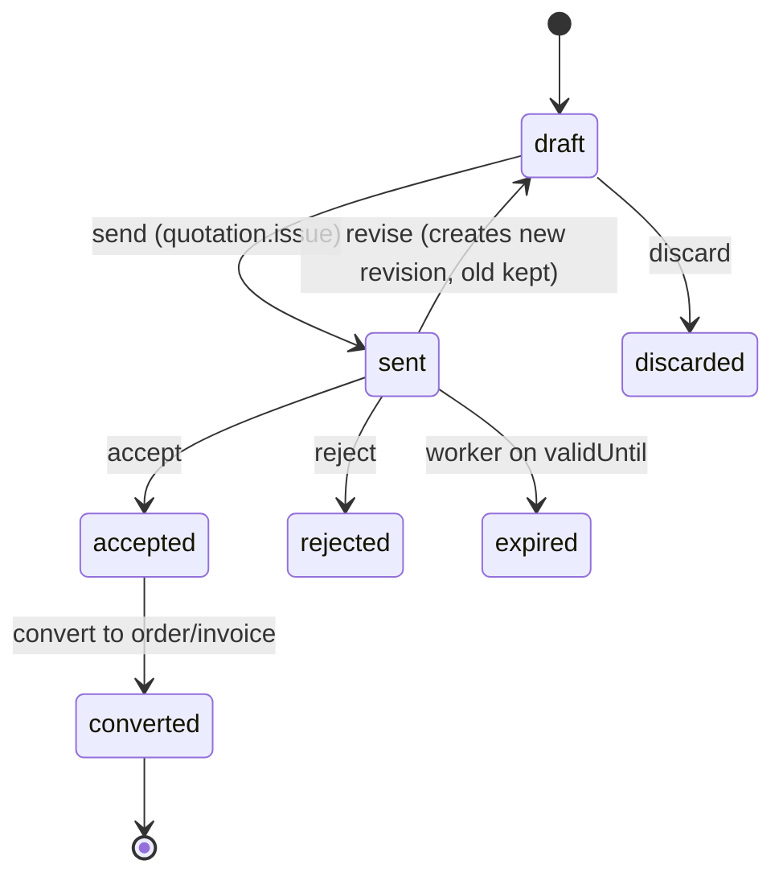
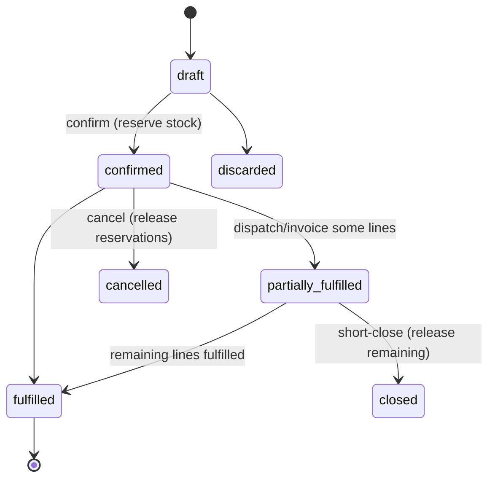
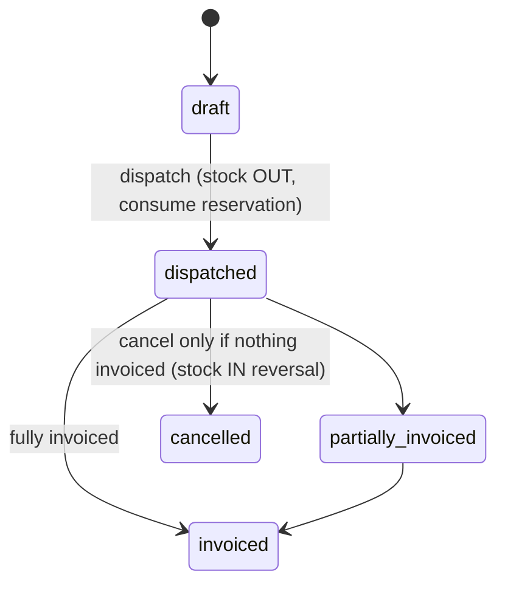
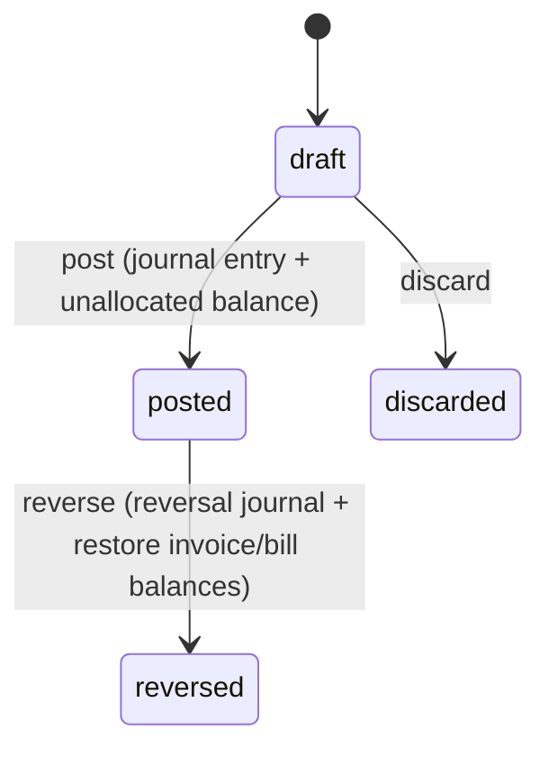
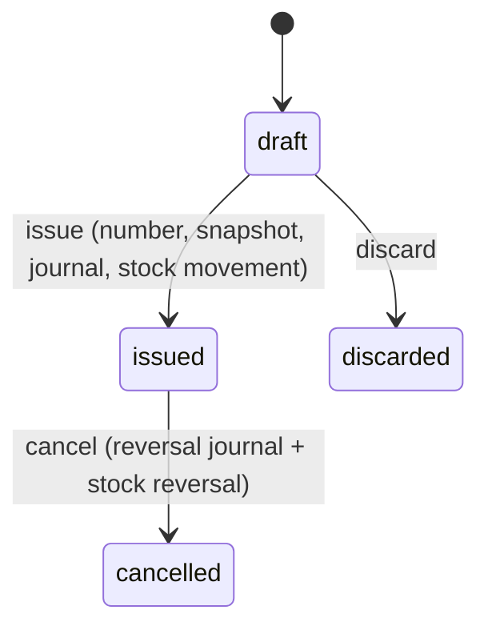
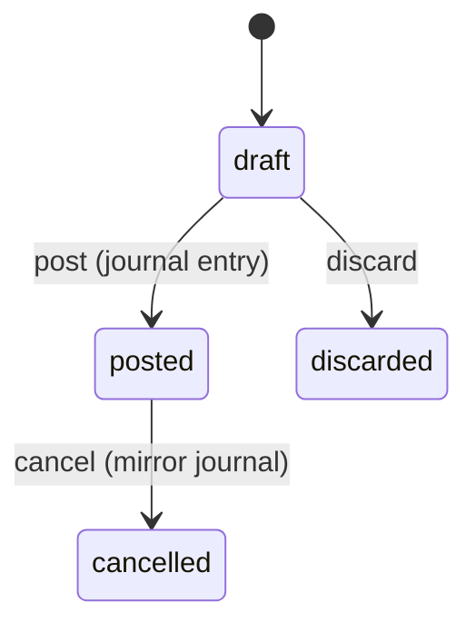

# Workflow and State-Transition Specification

Status: Draft v0.1 · 2026-10-19

Every transition is a server-side command (`POST /…/{id}:{action}`), authorized
by a specific permission, validated against the current state, executed in a
single database transaction where it touches money or stock, and written to the
audit log. Any transition not listed here is rejected with `409 INVALID_STATE`.

Common rules:
- **Draft** documents are freely editable by users holding `<doc>.edit`; they have no number, no posting, no stock effect.
- **Issue/confirm/post** assigns the number (from the scoped sequence), freezes an immutable snapshot (party, addresses, GSTINs, item names, HSN, rates, template version), posts journals and stock movements.
- **After issue**, only status transitions are permitted; corrections are by cancellation (if allowed) or by credit/debit note.
- Posting date must be after the legal entity's period-lock date.
- Concurrency: every document carries a `version`; updates use optimistic concurrency (`409 VERSION_CONFLICT`).

## 1. Quotation


Quotations carry a number on `send`. No stock or ledger effect. A proforma invoice is a quotation of kind `proforma` (own series). Converting makes a draft order or invoice; with the dispatch as stock-out point, a quotation with stock lines converts to an order only (Phase 7).

## 2. Sales order


Reservation = available-quantity reduction only. Fulfilment quantity per line ≤ ordered quantity.
Phase 7 notes:
- Confirm numbers the order and reserves each stock line in the order's warehouse; it is refused when not enough is available (unless negative stock is allowed).
- Fulfilled means dispatched (stock-out point dispatch) or invoiced (stock-out point invoice). Non-stock lines are fulfilled when invoiced from the order.
- Cancelling or short-closing releases what is still reserved. Cancelling a dispatch or invoice of an open (or fulfilled) order gives the order its quantities back and reserves them again.

## 3. Dispatch / delivery challan (only when stock-out point = `dispatch`)


Invoices raised against a dispatch **do not** move stock again (FR-INV-10). With the dispatch as stock-out point, an invoice's stock lines must come from a dispatch; an invoice made from an order carries its non-stock lines. A dispatch made from an order leaves from the order's warehouse and uses up its reservation.

## 4. Sales tax invoice / bill of supply

```mermaid
stateDiagram-v2
  [*] --> draft
  draft --> issued: issue (number, snapshot, journal, stock OUT if stock-out = invoice)
  draft --> discarded
  issued --> cancelled: cancel (reversal journal + stock reversal; e-invoice must be cancelled first if IRN exists)
  issued --> partially_paid: allocation
  partially_paid --> paid
  issued --> paid
```
- `paymentStatus` (unpaid/partially_paid/paid) is derived from allocations and tracked separately from `lifecycleStatus` (draft/issued/cancelled).
- Cancellation is blocked when allocations exist (de-allocate first) or when a credit note references the invoice. It needs the invoice's period to be open: the reversal is dated like the invoice.
- Issuing recomputes the figures from the current rates and masters. If the client sends the total it showed (`expectedTotal`) and it differs, the issue is refused for review.
- Regulatory sub-state (e-invoice): `not_applicable | pending | submitted | registered | failed | cancelled` — independent of lifecycle; see compliance doc.

## 5. Purchase order, goods receipt, supplier bill
- **PO:** `draft → issued → partially_received → received → closed | cancelled` (mirrors sales order; no stock effect).
- **Goods receipt** (stock-in point = `goods_receipt`): `draft → received (stock IN at PO rate, provisional) → billed | cancelled`. Supplier bill finalizes cost; the cost difference is posted as a valuation adjustment, not a second stock receipt.
- **Supplier bill:** `draft → posted → cancelled`; stock IN only if stock-in point = `supplier_bill`. Payment status derived like sales invoices.

## 6. Receipt / Payment, Allocations and Refunds



### 6.1 Payment Rules
- **Direction:** `incoming` (customer receipt) or `outgoing` (supplier payment).
- **Posting:** Assigns gap-free number (if configured) or series number, freezes payment snapshot, and creates balanced double-entry journal.
  - Incoming: Dr `1100 Cash`/`1110 Bank`, Cr `1200 Trade receivables` (allocated) + `2300 Customer advances` (unallocated).
  - Outgoing: Dr `2100 Trade payables` (allocated), Cr `1100 Cash`/`1110 Bank`.
- **Payment Method:** `cash`, `bank_transfer`, `upi`, `cheque`, `card`.
- **Unallocated Remainder:** Any excess payment over immediate allocations is tracked as `unallocatedAmount` on the payment and can be allocated later or refunded.

### 6.2 Allocation Rules
- **Linkage:** Links a posted payment to one or more eligible posted invoices (for receipts) or supplier bills (for disbursements).
- **Invariants:**
  - `Σ allocations <= payment.amount`.
  - `payment.unallocatedAmount = payment.amount - Σ allocations - Σ refunds`.
  - For each invoice/bill: `allocatedAmount <= obligation.outstanding`.
  - Strict tenant, legal-entity, and party scope: cross-party, cross-tenant, or cross-entity allocations are rejected.
  - Currency must match (INR).
- **Lifecycle & Balance Updates:**
  - Invoice/bill `outstanding` is atomically decremented by `allocatedAmount`.
  - If `outstanding == 0`, `paymentStatus = 'paid'`; if `0 < outstanding < grand`, `paymentStatus = 'partially_paid'`.
  - Does **not** post a secondary cash journal (cash was recognized on payment posting).
- **FIFO Allocation Policy:**
  - Optional automated allocation ordered by `docDate ASC, dueDate ASC, _id ASC`.
  - Fully transparent preview generated before execution.
  - Atomic execution in a single MongoDB transaction.

### 6.3 Payment Reversals and Refunds
- **Payment Reversal:**
  - Permitted only for `posted` payments with permission `payment.post`.
  - Blocked if any refund has been issued against the payment.
  - Atomically removes/cancels all linked allocations, restoring the `outstanding` balance and `paymentStatus` of all affected invoices/bills.
  - Creates a mirror reversal journal dated today (or original date if open).
  - Transition: `posted -> reversed`.
- **Refunds:**
  - Distinct from payment reversal: records money returned to customer (or received back from supplier) against an unallocated balance, advance, or credit note.
  - Preconditions: `refundAmount <= payment.unallocatedAmount`.
  - State machine: `draft -> approved -> posted -> reversed`.
  - Posts journal: Dr `2300 Customer advances` (or `1200 Trade receivables`), Cr `1110 Bank`/`1100 Cash`.
  - Atomically reduces `payment.unallocatedAmount`.

## 7. Returns, Credit Notes, and Debit Notes



### 7.1 Sales Returns & Credit Notes
- **Linkage:** Links to an issued sales invoice.
- **Quantity Validation:** For each returned item, cumulative `returnedQty <= invoicedQty - previouslyReturnedQty`.
- **Physical Goods:** Returned stock creates an `issue_return` / `return_in` movement in `StockLedger` using `restore` at the original issue unit cost, preventing valuation drift.
- **Credit Note:**
  - Reverses sales revenue and output GST: Dr `4100 Sales`, Dr `2210-2213 Output GST`, Cr `1200 Trade receivables`.
  - Reduces the invoice's outstanding balance, or creates an unallocated credit balance for the customer.
  - Cancellation creates mirror journal and reverses stock re-entry.

### 7.2 Purchase Returns & Debit Notes
- **Linkage:** Links to a posted supplier bill or received goods receipt.
- **Quantity Validation:** Cumulative `returnedQty <= billedQty - previouslyReturnedQty`.
- **Physical Goods:** Returned stock creates a `receipt_return` / `return_out` movement in `StockLedger` issuing stock out at the original receipt cost.
- **Debit Note:**
  - Reverses trade payable, inventory/expense, and input GST: Dr `2100 Trade payables`, Cr `1300 Inventory`/`5100 Purchases`, Cr `1410-1413 Input GST`.
  - Reduces supplier bill outstanding balance.

### 7.3 Standalone Price Adjustments
- Pure value adjustments without stock movement (e.g. post-sale volume discount or billing rate correction).
- Credit note value <= original invoice grand total - existing adjustments.

## 8. Expenses



- **Scope:** Operating expenses (rent, utilities, professional fees, repairs) distinct from inventory supplier bills.
- **Posting:** Dr `5400 Expenses`, Dr `1410-1413 Input GST` (if tax specified and ITC eligible), Cr `1100 Cash`/`1110 Bank` (if direct payment) or Cr `2100 Trade payables` (if unpaid).
- **Duplicate Prevention:** Enforces unique payee reference and date checks to prevent duplicate claims.

## 9. Party Statements
- Running balance ledger for Customers and Suppliers over a date range `[from, to]`.
- Opening balance computed deterministically from prior posted invoices, bills, payments, notes, and journals.
- Line items: date, document type, document number, debit, credit, running balance.
- Immutable PDF generation via worker outbox and pdfmake.

## 10. Stock transfer
`draft → dispatched (OUT source, IN transit) → received (OUT transit, IN destination) | cancelled (only from draft or dispatched with full reversal)`.

## 11. Stock adjustment and count
- Adjustment: `draft → posted` (requires reason code).
- Count: `draft → counting → submitted → posted` (variances become adjustment movements at current average cost).

## 12. Period lock
Lock date can move forward by users with `period.lock`; moving it backward requires `period.unlock` (Owner by default) and is audited with reason.

## 13. Background state (worker)
- Outbox event: `pending → processing (lease) → done | failed(retry n, backoff) → dead` (alerted).
- PDF artifact: `pending → ready | failed`.

